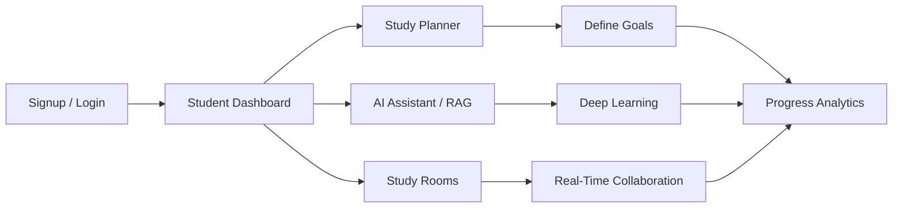
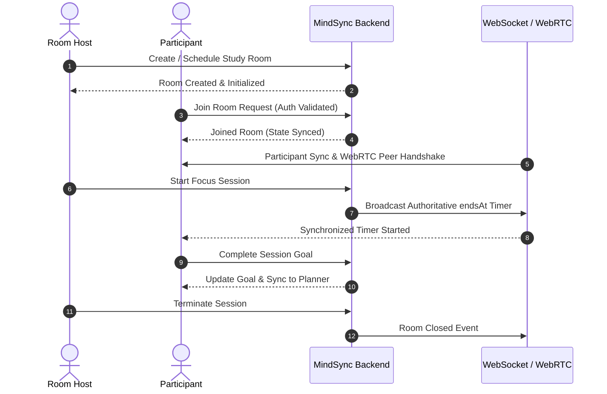

<div align="center">

# 🧠 MindSync

<p align="center">
  
</p>

<p align="center">
  <b>AI-powered collaborative learning platform for planning, focused study, and real-time collaboration.</b>
</p>

<p align="center">
  <a href="YOUR_LIVE_URL">🌐 Live Demo</a> •
  <a href="YOUR_GITHUB_URL">💻 Source Code</a> •
  <a href="#-features">📚 Features</a> •
  <a href="#-system-architecture">🧩 Architecture</a> •
  <a href="#-quick-start">🚀 Quick Start</a>
</p>

<p align="center">
  
  
  
  
  
  
  
</p>

---

</div>

## 📸 Screenshots Showcase

> Visual proof of MindSync in action — from personal planning to synchronized group focus and deep administrative observability.

| 🌟 1. Landing Page | 📊 2. Student Dashboard |
| :---: | :---: |
|  |  |

| 📅 3. Study Planner | 🏠 4. Collaborative Study Room |
| :---: | :---: |
|  |  |

| 🤖 5. AI / RAG Workshop | 🛡️ 6. Admin Dashboard |
| :---: | :---: |
|  |  |

| 📡 7. Admin AI Monitor | 📜 8. System Logs & Audit Trail |
| :---: | :---: |
|  |  |

<div align="center">
  <h3>📈 9. Platform Analytics</h3>
  
</div>

---

## ✨ Why MindSync?

Students commonly juggle 5 to 7 disconnected tools throughout their academic day:
- **Calendar & To-do lists** for planning assignments
- **Spreadsheets & Notion** for tracking goals
- **Discord & Zoom** for study calls and peer discussions
- **Pomodoro apps** for focus timers
- **External AI chatbots** for study questions with zero course context
- **Separate messaging apps** for communicating with classmates

This fragmented workflow drains focus, causes context switching, and loses valuable learning data across tools.

**MindSync solves this by bringing every stage of learning into one connected, collaborative ecosystem:**

```text
Plan  ──►  Study  ──►  Collaborate  ──►  Ask AI  ──►  Track Progress  ──►  Improve
```

---

## 🚀 Features

### 📚 Personalized Study Planner
A centralized academic workload manager and goal-tracking hub:
- **Intelligent Task Management**: Create, categorize, prioritize, and track pending and completed tasks.
- **Personal Study Goals**: Define target milestones, deadlines, and granular sub-goals.
- **Live Synchronization**: Seamlessly syncs planner tasks with active Study Rooms.
- **Resilient Linking**: Deleting or updating planner items never corrupts linked historical room sessions.

### 🏠 Collaborative Study Rooms
Virtual study spaces engineered for high focus and peer accountability:
- **Instant & Scheduled Rooms**: Launch an on-demand room or schedule sessions with automated start handling.
- **Public & Private Access**: Password-protected private rooms or discoverable public study hubs.
- **Live Room Status & Activity Feed**: Real-time participant states, camera statuses, and room event logs.
- **Host & Moderator Controls**: Mute participants, manage access, kick disruptive users, and lock rooms.
- **Integrated Tooling**: Unified video mesh, shared focus timer, session goals, and study chat.

### 🎥 Real-Time Communication (WebRTC + WebSockets)
Ultra-low-latency peer collaboration:
- **Peer-to-Peer Video (WebRTC)**: Multi-participant mesh signaling with deterministic offer/answer negotiation, ICE candidate buffering, and camera state synchronization.
- **WebSocket Event Gateway**: Real-time push notifications, live participant counters, timer state broadcasts, and instant moderation sync.

### ⏱️ Synchronized Focus Sessions
Eliminates out-of-sync Pomodoro timers across different clients:
- **Server-Controlled Expiry**: Session timers use an authoritative server `endsAt` timestamp.
- **Shared States**: Start, pause, resume, and reset transitions propagate in real time.
- **State Persistence**: Reconnecting or refreshing clients seamlessly resume the exact shared timer state without drifting.

### 🎯 Session Study Goals
Keep study groups accountable to specific session outcomes:
- **Create & Track Goals**: Set session targets inside the room.
- **Live Progress Updates**: Mark objectives complete as study progresses.
- **Planner Integration**: Synchronize session accomplishments directly back to the student's main planner.

### 💬 Privacy-Aware Study Chat
Rich, secure communication directly within study sessions:
- **Room-Wide Discussion**: Public chat stream for session participants.
- **Private & Direct Messaging**: 1-on-1 private messaging with participant selection.
- **Privacy Enforcement**: Server-side filtering guarantees that unauthorized room participants can never query or inspect direct messages not belonging to them.
- **Message Management**: Live message deletion and real-time delivery.

### 🤖 AI Study Assistant & RAG Workshop
Rather than an isolated generic chatbot, MindSync embeds AI directly into study workflows:
- **Context-Aware Study Support**: Answers questions based on academic context and curriculum materials.
- **RAG Architecture**: Retrieval-Augmented Generation processes documents to ground answers in trusted academic facts.
- **Independent AI Subsystem**: AI micro-services can be modified, swapped, or scaled without touching core room services.

```text
User Query ──► Request Processing ──► Context Retrieval ──► Grounded Reasoning ──► Study Response
```

### 🔐 Authentication & Server-Side Security
Security is baked into every layer rather than treated as a frontend afterthought:
- **JWT Authentication**: Secure token verification with automatic session validation and clean logout.
- **Role-Based Access Control (RBAC)**: Strict separation between standard Students, Room Hosts, Moderators, and Platform Admins.
- **Server-Side Moderation**: When a moderator mutes a user, the backend strictly rejects any unauthorized attempts to re-enable audio.
- **Protected Resources**: Backend ownership validation ensures users cannot access or alter another student's planner, private chat, or private room settings.

### 👨‍💼 Comprehensive Admin Dashboard
An all-in-one administrative hub for complete operational oversight:
- **User Management**: Monitor user accounts, access levels, and account states.
- **Study Room Administration**: Active room surveillance, force-terminate rooms, and moderate users.
- **Admin AI Monitor**: Observe LLM latency, token usage, prompt templates, and system health in real time.
- **Platform Analytics**: Interactive metrics on engagement, study hours, active rooms, and retention.
- **System Logs & Audit Trail**: Searchable, filterable audit trail for login history, admin actions, and security alerts.

---

## 🧩 System Architecture

```text
                         ┌─────────────────────────────────────────┐
                         │             React Frontend              │
                         │   Vite • React Router • WebRTC Client   │
                         └────────────────────┬────────────────────┘
                                              │
                                    REST APIs │ WebSockets
                                              │
                         ┌────────────────────▼────────────────────┐
                         │          Node.js / Express API          │
                         │  Auth Middleware • RBAC • Moderation    │
                         └──────┬──────────────┬─────────────┬─────┘
                                │              │             │
                 ┌──────────────▼───┐   ┌──────▼──────┐   ┌──▼───────────────┐
                 │ MongoDB Database │   │ Auth Engine │   │ AI / RAG Service │
                 │ Users • Rooms    │   │ JWT • Roles │   │ Context Engine   │
                 │ Tasks • Chat     │   └─────────────┘   └──────────────────┘
                 └──────────────────┘
                                │
                         ┌──────▼──────────────────────────────────┐
                         │            Real-Time Engine             │
                         │ WebSockets (Socket.io) • WebRTC Mesh    │
                         └─────────────────────────────────────────┘
```

---

## 🛠️ Technology Stack

| Layer | Technologies |
| :--- | :--- |
| **Frontend** | React.js 18, Vite, React Router, HTML5 / CSS3, Native WebRTC API, WebSocket Client |
| **Backend** | Node.js, Express.js, RESTful API Architecture, WebSockets, JWT Authentication |
| **Database** | MongoDB & Mongoose (Schema Validation, Indexes, Relational References) |
| **Real-Time** | WebRTC (Mesh topology, deterministic negotiation, ICE candidate buffering), WebSockets |
| **AI & RAG** | AI Integration Layer, Vector/Document Processing, Context-Aware Reasoning, AI Workshop |
| **Testing** | Automated Integration Suites, End-to-End Audits, WebSocket Handshake Tests, API Tests |

---

## 📁 Project Structure

```text
MindSync/
├── frontend/ (or Startup/)
│   ├── src/
│   │   ├── components/         # Reusable UI widgets, modals, navbar
│   │   ├── pages/              # Dashboard, Planner, Study Room, Admin, AI Workshop
│   │   ├── hooks/              # Custom hooks (useWebRTC, useSocket, useTimer)
│   │   ├── services/           # Axios REST services, API clients
│   │   ├── context/            # Auth, Room, and Notification state providers
│   │   └── ...
│   ├── public/                 # Static assets and icons
│   ├── package.json
│   └── vite.config.js
│
├── backend/
│   ├── src/ (or controllers/ & services/)
│   │   ├── controllers/        # Request handlers (auth, room, planner, admin)
│   │   ├── middleware/         # JWT verification, RBAC, moderation guards
│   │   ├── models/             # Mongoose schemas (User, Room, Task, Log)
│   │   ├── routes/             # REST route endpoints
│   │   ├── sockets/            # Real-time event handlers & WebRTC signaling
│   │   └── services/           # Business logic, RAG pipelines, audit logging
│   ├── docs/                   # Backend API references & schemas
│   ├── scripts/                # Database migrations & seed scripts
│   ├── .env.example
│   └── package.json
│
├── docs/
│   └── screenshots/            # Showcase images for README
│
└── README.md
```

---

## 🔄 Core Lifecycles & Flows

### 1. User Journey


### 2. Study Room Lifecycle


---

## 🧪 Testing & Verification Matrix

MindSync underwent rigorous end-to-end integration audits and automated test suites:

| Test Suite | Coverage Area | Status | Result |
| :--- | :--- | :---: | :---: |
| **E2E Integration Audit** | Complete multi-user room lifecycle & auto-start | ✅ | **11 / 11 PASSED** |
| **REST API Suite** | Authentication, CRUD operations, error handling | ✅ | **30 / 30 PASSED** |
| **Database Integrity** | Referential integrity, cascade handling, models | ✅ | **10 / 10 PASSED** |
| **Focus Synchronization** | Server `endsAt` drift resistance, pause/resume | ✅ | **10 / 10 PASSED** |
| **Role Separation & RBAC** | Host vs Moderator vs Student permissions | ✅ | **9 / 9 PASSED** |
| **WebSocket Handshake** | Token verification, reconnect resilience | ✅ | **5 / 5 PASSED** |
| **Planner Integration** | Goal syncing & resilient deleted task handling | ✅ | **7 / 7 PASSED** |
| **Realtime Signaling** | ICE candidate buffering, mesh offer/answer | ✅ | **6 / 6 PASSED** |
| **Frontend UI Verification** | Responsive layouts, audio/video toggles, chat | ✅ | **11 / 11 PASSED** |
| **Production Build** | Full TypeScript/JavaScript bundle compilation | ✅ | **PASSED** |

> **Audit Assurance**: All protected and frozen core Study Mode files passed verification with zero regressions.

---

## ⚡ Performance & Reliability Engineering

- **Resilient Real-Time Connection**: Automatic WebSocket reconnect with state reconciliation prevents data loss during transient network drops.
- **Race Condition Prevention**: Built-in ICE candidate queuing buffers remote candidates until the peer's `setRemoteDescription` completes.
- **Strict Defensive Data Handling**: Deleting a planner task never causes orphaned references or runtime errors in active or archived study sessions.
- **Zero Static Mock Data**: All views, lists, metrics, and room feeds are driven dynamically by live API and database endpoints.
- **Optimized Bundle**: Built with Vite for fast HMR in development and minimal bundle chunks in production.

---

## ⚙️ Quick Start

### 1. Prerequisites
- **Node.js**: v18.x or v20.x
- **MongoDB**: Local instance running on port `27017` or MongoDB Atlas URI
- **Git**

### 2. Clone Repository
```bash
git clone https://github.com/YOUR_USERNAME/mindsync.git
cd mindsync
```

### 3. Backend Setup
```bash
cd backend
npm install
cp .env.example .env
```

Configure your `.env` variables:
```env
PORT=5000
MONGODB_URI=mongodb://127.0.0.1:27017/mindsync
JWT_SECRET=your_super_secret_jwt_key
CLIENT_URL=http://localhost:5173
AI_API_KEY=your_ai_api_key_here
```

Start the backend server:
```bash
npm run dev
```

### 4. Frontend Setup
Open a new terminal window:
```bash
cd frontend    # or cd Startup
npm install
```

Configure your `.env` variables:
```env
VITE_API_URL=http://localhost:5000/api
VITE_WS_URL=http://localhost:5000
```

Start the frontend development server:
```bash
npm run dev
```

Open your browser at `http://localhost:5173` to explore MindSync!

---

## 🔒 Security Best Practices

- Never commit `.env` or sensitive credentials to version control.
- Ensure `JWT_SECRET` is set to an unpredictable, high-entropy string in production.
- Use TLS/HTTPS in production to protect WebRTC peer exchange and WebSocket traffic.
- Moderation operations (mute, kick, lock) must always route through authenticated backend endpoints.

---

## 📌 Project Status

- [x] **Core Platform Architecture**
- [x] **JWT Authentication & Session Management**
- [x] **Role-Based Authorization (Admin, Host, Moderator, Student)**
- [x] **Personalized Study Planner & Priority Tasks**
- [x] **Study Rooms (Public, Private, Scheduled)**
- [x] **Automated Scheduled Room Lifecycle Engine**
- [x] **WebRTC Peer-to-Peer Video Mesh Signaling**
- [x] **WebSocket Real-Time Event Pipeline**
- [x] **Synchronized Focus Sessions with Server Authority**
- [x] **Session Goals with Study Planner Sync**
- [x] **Room-Wide & Privacy-Protected Direct Chat**
- [x] **Server-Side Moderation & Mute Enforcement**
- [x] **AI Study Assistant & RAG Workshop**
- [x] **Admin Dashboard with System Logs & Audit Trail**
- [x] **Admin AI Monitor & Prompt Management**
- [x] **Application-Wide Analytics**
- [x] **End-to-End Automated Test Verification**
- [x] **Production Bundle Readiness**

---

## 🏆 What Sets MindSync Apart?

Most platforms offer a solitary piece of the study puzzle:

```text
                     ┌────────────────────────────────┐
                     │            MindSync            │
                     └───────────────┬────────────────┘
                                     │
         ┌───────────────────────────┼───────────────────────────┐
         │                           │                           │
         ▼                           ▼                           ▼
  [Study Planner]              [AI / RAG Hub]              [Study Rooms]
         │                           │                           │
         │                           │                     ┌─────┴─────┐
         ▼                           ▼                     ▼           ▼
   Academic Goals              Academic Help             Video       Chat
         │                                                 │           │
         └───────────────────────────┬─────────────────────┴───────────┘
                                     ▼
                          Unified Learning Flow
                                     ▼
                           Continuous Improvement
```

MindSync integrates planning, deep work, peer accountability, AI tutoring, and actionable metrics into one continuous feedback loop.

---

## 🗺️ Roadmap & Future Enhancements

- [ ] **SFU Media Server Architecture**: Transitioning from peer mesh to Selective Forwarding Units (Mediasoup / LiveKit) for 50+ participant study rooms.
- [ ] **Cross-Platform Mobile App**: React Native client for on-the-go study sessions.
- [ ] **AI-Powered Adaptive Scheduling**: Automated study schedule generation based on task deadlines and learning pace.
- [ ] **Predictive Academic Analytics**: Early warnings when study goal velocities fall behind target milestones.
- [ ] **Collaborative Whiteboard**: Synchronized interactive canvas inside study rooms.

---

## 🤝 Contributing

Contributions are what make the open-source community an incredible place to learn, inspire, and create. Any contributions you make are **greatly appreciated**.

1. Fork the Project (`https://github.com/YOUR_USERNAME/mindsync/fork`)
2. Create your Feature Branch (`git checkout -b feature/AmazingFeature`)
3. Commit your Changes (`git commit -m 'feat: Add AmazingFeature'`)
4. Push to the Branch (`git push origin feature/AmazingFeature`)
5. Open a Pull Request

---

## 📜 License

Distributed under the **MIT License**. See `LICENSE` for more information.

---

## 👨‍💻 Author

**Nikhil Palyal**  
*Computer Science Engineering — Artificial Intelligence*  
- **GitHub**: [@nikhilpalyal6](https://github.com/nikhilpalyal6)  
- **LinkedIn**: [Nikhil Palyal](https://linkedin.com)  

<p align="center">
  Built with ❤️, JavaScript, AI, and a passion for modern student collaboration.
</p>
